# Peer Watchalong

Peer Watchalong is a peer-assisted video watch party for a local network. A host
chooses an MP4 file and controls play, pause, and seek. Viewers receive video
chunks from the host and other viewers over WebRTC DataChannels, then play them
in the browser. A Node.js WebSocket tracker coordinates rooms, peer connections,
chunk discovery, and the shared playback timeline; it does not relay video
bytes.

This is a working MVP, not a production streaming service. It has been tried
manually with a host and viewers in separate browser windows. Its performance
and reliability at larger scale have not been established.

## How it works

```mermaid
flowchart LR
  subgraph setup["1 · Set up the room"]
    direction TB
    A["Host creates room<br/>and selects MP4"] --> B["Prepare segments<br/>and manifest with SHA-256 hashes"]
    C["Viewer enters room code"] --> D["Tracker shares manifest,<br/>topology, and playback state"]
    B --> D
  end

  subgraph delivery["2 · Deliver chunks"]
    direction TB
    E["Open authorized<br/>WebRTC DataChannels"] --> F["Plan chunks near<br/>the host's position"]
    F --> G["Ask tracker for holders;<br/>request from a peer"]
    G --> H{"SHA-256 valid?"}
    H -- "No: retry" --> G
  end

  subgraph playback["3 · Play in sync"]
    direction TB
    I["Cache chunk and announce<br/>it to the tracker"] --> J["Append to browser<br/>Media Source buffers"]
    J --> K["Follow host play, pause, and seek<br/>using tracker clock samples"]
  end

  D --> E
  H -- Yes --> I

  classDef browser fill:#e9f3ff,stroke:#4776a4,color:#162d44
  classDef tracker fill:#eee9ff,stroke:#735ba3,color:#2d2146
  classDef check fill:#e8f7ef,stroke:#458365,color:#183b2a
  class A,B,C,E,F,I,J,K browser
  class D,G tracker
  class H check
```



1. The tracker creates a room, assigns peer identities and neighbors, and
   permits signaling only between authorized neighbors.
2. The host splits its local MP4 into video intervals and bundles each video's
   fragment with nearby audio fragments. It sends the tracker a moving manifest
   window containing chunk times, codecs, sizes, and SHA-256
   hashes, then announces which chunks it holds.
3. Each viewer plans downloads around the host's current position, asks the
   tracker which neighboring peers have those chunks, and transfers the bytes
   directly over WebRTC. Viewers verify each chunk before caching or relaying
   it. The tracker never stores the file or handles its media traffic.
4. The host publishes play, pause, and seek state to the tracker. Viewers use
   tracker clock samples to estimate the expected position, adjust playback
   speed for small drift, and seek for larger changes. Verified chunks are
   appended to browser Media Source buffers for playback.

The tracker keeps room membership, topology, playback state, and chunk-holder
claims in memory. For implementation details, see
[architecture](docs/architecture.md), [topology](docs/topology.md),
[network messages](docs/contract.md), and
[scheduling and playback sync](docs/scheduling-and-sync.md). The
[WebRTC package](packages/webrtc/README.md) and
[scheduler package](packages/scheduler/README.md) document their APIs.

## Run locally

You need Node.js 22.12 or newer, pnpm 11, and a browser with WebRTC and Media
Source support. From the repository root:

```sh
pnpm install
```

Start the tracker and web app in separate terminals:

```sh
pnpm --filter @peer-watchalong/tracker start
```

```sh
pnpm --filter @peer-watchalong/web dev
```

Open <http://localhost:5173>. Create a room as the host, choose an MP4 file,
and share the room code. Open another browser window, choose **Viewer**, and
join with that code. The host's video controls drive all viewers. A viewer may
need to click **Start watching** if the browser blocks autoplay with sound.
Viewers have no seek controls.

The web app connects to `ws://<browser hostname>:8080` by default. For a
different tracker address, set `VITE_TRACKER_URL` when starting the web app:

```sh
VITE_TRACKER_URL=ws://192.168.1.10:8080 pnpm --filter @peer-watchalong/web dev
```

The tracker accepts `TRACKER_HOST`, `TRACKER_PORT`, and
`TRACKER_MAX_PAYLOAD_BYTES` for its bind address, port, and control-message
limit. Update `VITE_TRACKER_URL` if you change its address or port.

For LAN testing, open the web app using the host computer's LAN address on
other devices and ensure they can reach the tracker on port 8080. The project
does not currently provide a TURN relay or a hosted deployment.

## Repository layout

| Path | Responsibility |
| --- | --- |
| [`apps/tracker`](apps/tracker) | WebSocket server, room registry, peer topology, and authoritative playback state |
| [`apps/web`](apps/web) | Host and viewer UI, MP4 preparation, peer exchange, and browser playback |
| [`packages/protocol`](packages/protocol) | Shared message types, binary chunk framing, and validation |
| [`packages/tracker-client`](packages/tracker-client) | Browser-side WebSocket control client |
| [`packages/webrtc`](packages/webrtc) | Peer connection and DataChannel wrappers |
| [`packages/scheduler`](packages/scheduler) | Chunk requests, holder selection, clock sync, and playback decisions |
| [`tests`](tests) | Automated protocol, tracker, scheduling, and browser-logic tests |

## Checks and current limits

Run the automated checks with:

```sh
pnpm test
pnpm typecheck
pnpm --filter @peer-watchalong/web build
```

These checks cover individual components and some tracker integration paths.
Comprehensive end-to-end, cross-device, failure-recovery, and scale testing has
**not** been done. There are no published benchmarks yet; viewer capacity,
startup time, sync error, rebuffering, and host bandwidth savings have not been
measured systematically. The topology has a configured maximum of 25 viewers,
but that is a design limit, not a validated performance result.

Current limitations:

- Rooms and chunk claims are in memory. A viewer refresh rejoins the saved
  room. A host refresh can reclaim the same room within 30 seconds using a
  private browser session token. The host's selected file is restored from
  browser storage when available; if storage fails, the host must select it
  again. A viewer's cached chunks are downloaded again after refresh. An
  explicit host departure closes the room immediately, and tracker restarts
  still lose all rooms.
- Only MP4 files under 256 MB with browser-supported codecs are accepted. Each
  published metadata window is limited to 512 segments and 48 KB; an individual
  bundle cannot exceed 16 MB. The host still segments the full file locally
  before sharing starts, then hashes and publishes nearby chunks. Audio fragment
  boundaries can cross video intervals, so seeking may fetch the preceding bundle.
- Media is prepared and cached in browser memory. Buffer eviction and
  long-running memory behavior still need work.
- The app targets LAN use. Connectivity across different networks has not been
  validated, and there is no TURN fallback.

## LLM use

LLMs were used to assist with coding this project. Every design decision and
the resulting code have been thoroughly reviewed by the project author.
